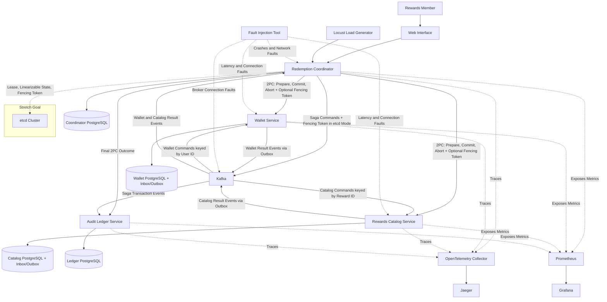

# LedgerMesh: Distributed Transaction Coordination for a Rewards System

## Abstract

LedgerMesh is a distributed rewards-redemption system that compares **Two-Phase Commit (2PC)** and the **Saga pattern** for maintaining transaction correctness across independently deployed services. Redeeming a reward requires the system to deduct customer points, reserve reward inventory, and record the transaction. Because these operations are handled by separate services with independently owned databases, crashes, timeouts, duplicate messages, out-of-order events, and concurrent requests can leave the system inconsistent.

The 2PC implementation will use synchronous REST communication and PostgreSQL prepared transactions. Participating services will vote during the prepare phase, while the Redemption Coordinator will durably record the final commit or abort decision. The Saga implementation will use asynchronous Kafka events and compensating actions, such as refunding points or releasing reserved inventory, when a later step fails.

To address **out-of-order delivery and concurrency races**, Wallet commands will be partitioned by user ID, Catalog commands will be partitioned by reward ID, and workflow events will include monotonic transaction sequence numbers. Duplicate or stale operations will be rejected using idempotency keys and sequence validation. PostgreSQL optimistic concurrency control with version columns will prevent double-spending and overselling. It will be used instead of Redis Redlock because the databases owning the balances and inventory can enforce correctness without requiring a separate distributed lock service.

For the **etcd split-brain stretch goal**, the active Coordinator will hold a renewable lease and use linearizable reads and writes. It will step down and reject new redemptions if it loses its lease or access to the etcd quorum. Each Coordinator leadership period will have a fencing token, and participating services will reject commands containing a stale token.

OpenTelemetry traces, structured logs, and Prometheus metrics will be used to compare correctness, availability, latency, blocking behavior, compensation frequency, and recovery time.

## Project Objectives and Research Questions

LedgerMesh is both a working distributed application and a controlled experiment. The project will answer the following questions:

1. How do 2PC and Saga differ in correctness, availability, latency, blocking behavior, and recovery under the same workload and failure conditions?
2. Can per-aggregate ordering, idempotent consumers, and optimistic concurrency control prevent double-spending and ghost inventory when Kafka messages are duplicated, delayed, reordered, or processed concurrently?
3. How should an active Redemption Coordinator behave when it loses its etcd lease or quorum connection, and can fencing tokens prevent a stale Coordinator from changing transaction state?

## System Scope

### Core services

- **Redemption Coordinator:** Starts and tracks redemptions, executes either the 2PC or Saga workflow, records durable decisions, and exposes transaction status.
- **Wallet Service:** Owns customer point balances and prevents a balance from being spent more than once.
- **Rewards Catalog Service:** Owns reward inventory and prevents overselling or ghost reservations.
- **Audit Ledger Service:** Stores an immutable history of commands, events, decisions, compensations, and recovery actions.
- **Web Interface:** Allows a user to view balances and inventory, submit redemptions, and inspect transaction progress.

### Required implementation scope

- Implement the same redemption workflow using both 2PC and Saga.
- Run all services independently with service-owned PostgreSQL databases.
- Use Kafka for Saga commands and events.
- Handle duplicate, delayed, reordered, stale, and concurrently processed messages.
- Inject repeatable failures and compare both approaches using the same workload.
- Propagate a common transaction ID through REST requests, Kafka records, logs, metrics, and traces.

### Stretch scope

- Replicate Coordinator leadership and transaction state through a three-member etcd cluster.
- Deploy the stable Docker Compose implementation to Kubernetes.

## Correctness Invariants

The following conditions must hold after every completed or recovered transaction:

1. A successful redemption deducts points exactly once, reserves inventory exactly once, and records one final successful outcome.
2. A failed or compensated redemption leaves no permanent point deduction and no permanent inventory reservation.
3. A customer balance and reward inventory count can never become negative.
4. Replaying the same command or event does not change the final result.
5. A stale message, invalid state transition, or command from an old Coordinator leadership term is rejected and recorded.
6. Every accepted state transition is traceable to its transaction ID, causation ID, sequence number, and Coordinator fencing token when etcd mode is enabled.

## Transaction Coordination Designs

### Two-Phase Commit workflow

1. The Coordinator creates a transaction record and sends `PREPARE` requests to the Wallet and Catalog services.
2. Each participant validates its local constraints, opens a PostgreSQL prepared transaction, and votes `YES` or `NO`.
3. The Coordinator durably records `COMMIT` or `ABORT` before sending the final decision.
4. Participants commit or roll back their prepared transactions and return an idempotent acknowledgement.
5. After a crash, the Coordinator reads its durable decision log and retransmits the same decision until all participants acknowledge it.

The experiment will explicitly measure the blocking period created when participants remain prepared but cannot learn the Coordinator's decision.

### Saga workflow

1. The Coordinator publishes a command to deduct points.
2. After the Wallet succeeds, the Coordinator publishes a command to reserve inventory.
3. If all steps succeed, the Coordinator marks the redemption complete and publishes the final outcome.
4. If a later step fails, compensating commands refund points and release any completed reservation.
5. Every step and compensation is idempotent and is accepted only when it represents a valid state-machine transition.

## Ordering, Idempotency, and Concurrency Strategy

Kafka partition ordering alone is not sufficient because a redemption touches both a customer and a reward, and multiple consumer threads can race. LedgerMesh will therefore enforce ordering and concurrency at several layers.

### Event envelope

Every Saga command and event will include:

- `event_id`: globally unique identifier used for deduplication
- `transaction_id`: redemption workflow identifier
- `correlation_id`: connects all operations belonging to one redemption
- `causation_id`: identifies the command or event that caused this message
- `aggregate_type` and `aggregate_id`: identify the Wallet or Catalog entity being changed
- `aggregate_version`: monotonic sequence number for that entity
- `workflow_step`: expected Saga state transition
- `coordinator_fencing_token`: leadership token when etcd mode is enabled
- `occurred_at`: timestamp for observability only, not for ordering decisions

### Partitioning and causal ordering

- Wallet commands will be keyed by `user_id`, and Catalog commands will be keyed by `reward_id`, preserving Kafka order for each protected aggregate within a partition.
- Consumers will compare `aggregate_version` and the expected workflow state before applying an operation.
- Duplicate or older versions will return the previously stored result without changing business data.
- A future version that arrives before a required earlier version will be deferred or sent to a retry topic until the missing transition is available; after a configured limit it will move to a dead-letter topic for investigation.
- `causation_id` and the Coordinator state machine will prevent a logically later Saga step from being accepted before its prerequisite step.

The baseline will use monotonic per-aggregate sequence numbers because they are sufficient for this workflow and simpler to evaluate. Vector clocks may be evaluated as an extension if the design later permits concurrent updates from multiple independent writers.

### Duplicate and concurrent consumption

- Each service will maintain an **inbox table** with a unique constraint on `event_id`.
- The inbox record and the business update will be committed in the same local database transaction.
- PostgreSQL version columns and conditional updates such as `UPDATE ... WHERE version = expected_version` will provide optimistic concurrency control.
- Balance deductions and inventory reservations will also include atomic nonnegative-value checks.
- A conflicting worker will retry from fresh state; it will never blindly repeat the mutation.
- An **outbox table** will store outgoing events in the same transaction as the local business change, preventing a committed database update from being lost before its event is published.

This design uses database-level optimistic concurrency control rather than Redis Redlock for the required implementation. Redis locking may be added only as a comparison; correctness will not depend on a lock that is separate from the database owning the balance or inventory.

## etcd Quorum, Leadership, and Split-Brain Protection — Stretch Goal

The etcd extension will use a three-member cluster so that a majority quorum is required for progress. etcd's consensus protocol prevents two partitions from both committing state, but a previously active Coordinator may temporarily continue running with stale leadership information. LedgerMesh will protect the system as follows:

1. A Coordinator must acquire a renewable etcd lease before accepting new redemptions.
2. Coordinator state and leadership checks will use linearizable reads and writes.
3. Each successful leadership acquisition will produce a monotonically increasing fencing token derived from an etcd revision or election record.
4. The fencing token will be attached to every command sent to Wallet and Catalog services.
5. Participants will persist the highest accepted fencing token and reject commands carrying an older token.
6. If the Coordinator cannot renew its lease or confirm quorum within the configured safety interval, it will step down, stop producing transaction commands, and reject new redemptions with a temporary-unavailable response.
7. After quorum is restored, a newly elected Coordinator will reconcile incomplete transactions from durable state before accepting or resuming work.

The split-brain experiment will isolate one etcd member together with the active Coordinator. The isolated side must stop accepting work after lease loss, while the quorum side elects or retains the only valid leader. The test will verify that no conflicting terminal transaction states are committed.

## Business Value

Rewards programs are used by credit-card companies, airlines, hotels, retailers, gaming platforms, and employee-recognition programs. A failed distributed transaction could deduct customer points without delivering a reward, issue the same reward more than once, or reserve inventory that is no longer available.

LedgerMesh demonstrates how a distributed rewards platform can:

- Provide measurable evidence for choosing between 2PC and Saga
- Protect customer point balances during partial failures
- Prevent double-spending and duplicate reward allocation
- Recover incomplete transactions through aborts or compensating actions
- Detect and safely ignore duplicate or stale messages
- Maintain an auditable history of transaction decisions and recovery actions
- Give operators visibility into failures through logs, metrics, and distributed traces

Although LedgerMesh uses rewards redemption as its business scenario, the same transaction-coordination problem appears in e-commerce orders, payment processing, travel reservations, banking transfers, food-delivery workflows, and cloud-resource provisioning.

## Proposed Architecture Diagram

## Proposed Technologies Used

| Technology | Proposed use |
|---|---|
| **Python** | Primary implementation language |
| **FastAPI** | APIs for the Coordinator, Wallet, Catalog, and Audit Ledger services |
| **PostgreSQL** | Service-owned data, durable Coordinator decisions, prepared transactions, idempotency records, and optimistic concurrency control |
| **SQLAlchemy and psycopg** | Database access and transaction management |
| **Kafka** | Asynchronous Saga commands and events, partitioned by the entity being protected |
| **aiokafka** | Python Kafka producer and consumer client |
| **HTML, CSS, and JavaScript** | Lightweight rewards and transaction-status interface |
| **Docker and Docker Compose** | Baseline local deployment and multi-service development environment |
| **Kubernetes** | Deployment and failure demonstrations after the Docker Compose baseline is stable |
| **OpenTelemetry** | Distributed trace creation and propagation across REST calls and Kafka events |
| **Prometheus** | Collection and storage of application and system metrics |
| **Grafana** | Metrics dashboards and 2PC-versus-Saga comparison results |
| **Jaeger** | End-to-end distributed trace visualization |
| **Locust** | Load testing and concurrent-redemption generation |
| **Toxiproxy and Docker controls** | Network latency, connection failures, service pauses, and crash injection |
| **Pytest** | Unit, integration, concurrency, idempotency, and recovery testing |
| **etcd — Stretch Goal** | Lease-based leader election, linearizable Coordinator state, quorum-loss detection, and fencing tokens |

## Failure-Injection and Evaluation Plan

Each experiment will run against both 2PC and Saga where applicable, using repeatable Locust workloads and controlled fault injection.

| Scenario | Injection method | Expected safety behavior | Measurements |
|---|---|---|---|
| Coordinator crash | Stop the Coordinator before or after its decision | Recovery uses the durable decision/state log; no conflicting outcome | Recovery time, blocked transactions, correctness violations |
| Participant crash | Stop Wallet or Catalog during processing | 2PC waits/recovers; Saga retries or compensates | Availability, latency, compensation count |
| Duplicate delivery | Republish the same event and process it concurrently | Inbox uniqueness and idempotency prevent repeated mutations | Duplicate rejection count, final balances and inventory |
| Out-of-order delivery | Delay an earlier event and deliver a later sequence first | Consumer defers/retries the future event and rejects stale transitions | Reorder recovery time, retry count, dead-letter count |
| Concurrent redemption | Submit many requests for the same user and reward | Optimistic concurrency prevents negative balance and overselling | Conflict rate, throughput, p95 latency |
| Kafka interruption | Block or delay broker connectivity | Local changes are later published from the outbox; retries remain idempotent | Backlog size, recovery time, lost-event count |
| Network timeout | Add latency or disconnect a REST/Kafka path | Retried operations do not create a second mutation | Timeout rate, retry rate, final correctness |
| etcd minority partition (stretch) | Partition the active Coordinator from quorum | Lease expires, Coordinator steps down, stale fencing tokens are rejected | Failover time, rejected stale commands, conflicting decisions |

## Evaluation Metrics

- **Correctness:** invariant violations, negative balances, oversold inventory, duplicate final outcomes, and unresolved transactions
- **Availability:** successful-redemption percentage while failures are active
- **Performance:** throughput and p50/p95/p99 end-to-end latency
- **Recovery:** time to reach a terminal state after fault removal
- **2PC behavior:** prepared-transaction blocking time and unresolved participant count
- **Saga behavior:** retry count, compensation frequency, and compensation completion time
- **Messaging:** duplicates rejected, stale events rejected, reordered events recovered, and dead-letter events
- **Leadership (stretch):** lease-loss detection time, failover time, and stale fencing-token rejection count

## Expected Deliverables

- Source code for all independently deployable services
- Docker Compose environment and optional Kubernetes manifests
- Database schemas and migration scripts
- Kafka topic and event-envelope documentation
- Automated unit, integration, concurrency, idempotency, recovery, and invariant tests
- Failure-injection scripts with repeatable experiment configurations
- Grafana dashboards and Jaeger traces
- A final comparison report explaining when 2PC or Saga is the better choice based on measured results
