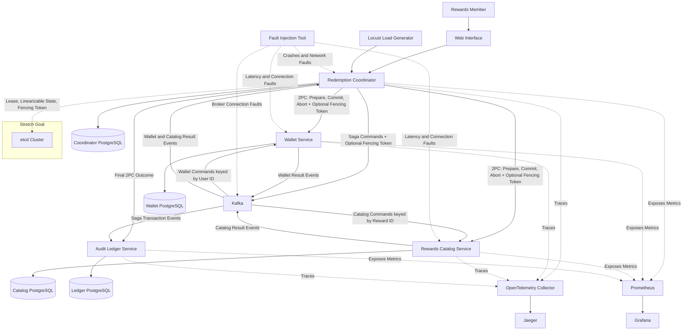

# LedgerMesh: Distributed Transaction Coordination for a Rewards System

## Abstract

LedgerMesh is a distributed rewards-redemption system that compares **Two-Phase Commit (2PC)** and the **Saga pattern** for coordinating transactions across independently deployed services. A reward redemption requires the system to deduct customer points, reserve reward inventory, and record the transaction outcome. These operations span separate databases, so a service crash, network timeout, or concurrent request can leave a customer charged without a reward or allow the same inventory to be allocated more than once.

The project will implement the same redemption workflow using both coordination approaches. In 2PC mode, a Redemption Coordinator will use synchronous REST requests and PostgreSQL prepared transactions to obtain participant votes, durably record a commit or abort decision, and recover unfinished transactions. In Saga mode, services will exchange asynchronous Kafka commands and events, using compensating actions such as refunding points and releasing inventory when a later step fails. Idempotent processing, message ordering checks, and database concurrency controls will address duplicate messages, out-of-order delivery, and simultaneous redemptions.

Both approaches will be evaluated under equivalent workloads and controlled failures, including service crashes, delayed messages, and network interruptions. The comparison will measure transaction correctness, availability, throughput, latency, and recovery time, with particular attention to blocking in 2PC and compensation in Saga. The intended result is a working application and experimental evidence explaining the tradeoffs between the two approaches.

## Business Value

Rewards programs used by retailers, airlines, banks, and employee-recognition platforms depend on accurate customer balances and reliable reward fulfillment. An incomplete transaction can deduct points without reserving a reward, while duplicate or concurrent requests can cause double-spending or overselling. These failures create customer disputes, manual reconciliation work, and financial losses.

LedgerMesh aims to protect customer balances and reward inventory during partial failures and provide a traceable record of each redemption. Operators will be able to inspect transaction status, identify failed steps, and observe recovery through logs, metrics, and distributed traces. An audit history will support investigation of whether a transaction completed, aborted, or required compensation.

The comparison will help engineering teams assess the availability and performance costs of 2PC against the recovery complexity and temporary inconsistencies of Saga. Rather than assuming one approach fits every application, the project will demonstrate their behavior under the same conditions. These findings can also inform distributed workflows in e-commerce orders, payment processing, and travel reservations.

## Proposed Architecture Diagram

The architecture separates customer balances, reward inventory, workflow coordination, and auditing into services that each own a PostgreSQL database:

- **Web Interface:** Lets a rewards member view available points and rewards, submit a redemption, and check its transaction status.
- **Redemption Coordinator:** Creates a transaction ID, tracks workflow progress, and executes either the 2PC or Saga workflow. Its database stores transaction state and durable coordination decisions used during recovery.
- **Wallet Service:** Validates available points and applies deductions or refunds. Idempotency checks and database concurrency controls will prevent repeated deductions and negative balances.
- **Rewards Catalog Service:** Validates availability and reserves or releases reward inventory. Concurrent requests will be checked to prevent overselling.
- **Audit Ledger Service:** Records transaction outcomes and relevant events, allowing a redemption to be traced across services.
- **Kafka:** Carries Saga commands and result events between the Coordinator and participant services, and delivers Saga events to the Audit Ledger.

In **2PC mode**, the Coordinator asks the Wallet and Catalog services to prepare their changes. It records the final commit or abort decision before notifying both participants, then records the outcome through the Audit Ledger. In **Saga mode**, the Coordinator drives the workflow through Kafka, deducting points before reserving inventory. If a later step fails, it requests compensation for completed steps. Each mode uses the same business operations so their behavior can be compared fairly.

The diagram also shows the tools used to evaluate the workflows. Locust submits repeatable redemption workloads to the Coordinator. Toxiproxy and Docker controls introduce network faults, delays, pauses, and crashes affecting the Coordinator, participant services, and Kafka. Services send traces to the OpenTelemetry Collector for visualization in Jaeger and expose metrics for Prometheus, which Grafana displays in comparison dashboards.

The **etcd cluster is a stretch goal** for Coordinator leadership and split-brain protection. A renewable lease will identify the active Coordinator, while linearizable state operations and fencing tokens will help prevent a stale leader from changing transaction state. The Coordinator will step down if it loses its lease or quorum access, and participants will reject commands with stale fencing tokens. The optional fencing tokens shown on the transaction paths apply when this extension is enabled.

## Proposed Technologies Used

| Technology | Proposed use |
|---|---|
| **Python and FastAPI** | Implement the Coordinator, Wallet, Catalog, and Audit Ledger services, with REST endpoints for redemption requests, transaction status, and 2PC coordination. |
| **PostgreSQL** | Maintain separate service-owned databases for balances, inventory, workflow state, and audit records. Prepared transactions support 2PC; constraints and version checks protect against conflicting updates. |
| **SQLAlchemy and psycopg** | Provide database access and local transaction management, including the PostgreSQL operations needed for prepared transactions. |
| **Kafka and aiokafka** | Exchange asynchronous Saga commands and result events. Partition keys preserve per-entity message order, while application checks handle duplicate and stale messages. |
| **HTML, CSS, and JavaScript** | Build a lightweight interface for viewing balances and rewards, submitting redemptions, and inspecting transaction progress. |
| **Docker and Docker Compose** | Package the services and run them with PostgreSQL, Kafka, and observability tools in a reproducible local environment. |
| **OpenTelemetry Collector and Jaeger** | Instrument services and propagate transaction context across REST requests and Kafka messages. The Collector receives and exports traces to Jaeger for visualization of delays and failures. |
| **Prometheus and Grafana** | Collect and display throughput, latency, failure, retry, compensation, and recovery metrics for the 2PC-versus-Saga comparison. |
| **Pytest** | Verify business rules, idempotency, concurrency handling, and recovery behavior through unit and integration tests. |
| **Locust** | Generate repeatable redemption workloads, including simultaneous requests for the same customer or reward. |
| **Toxiproxy and Docker controls** | Introduce network delays, disconnections, service pauses, and crashes to evaluate behavior during partial failures. |
| **etcd — Stretch Goal** | Provide lease-based Coordinator leadership, linearizable state operations, and fencing tokens to protect against stale leaders during quorum loss or network partitions. |
| **Kubernetes — Stretch Goal** | Deploy the services after the Docker Compose baseline is stable and extend deployment and failure demonstrations to a cluster environment. |
