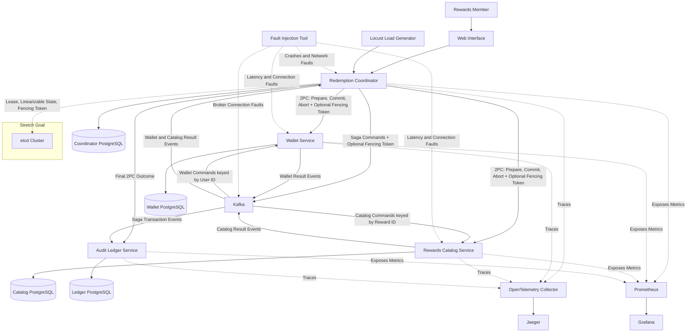

# LedgerMesh: Distributed Transaction Coordination for a Rewards System

## Abstract

LedgerMesh is a distributed rewards-redemption system that compares **Two-Phase Commit (2PC)** and the **Saga pattern** for maintaining transaction correctness across independently deployed services. Redeeming a reward requires the system to deduct customer points, reserve reward inventory, and record the transaction. Because these operations are handled by separate services with independently owned databases, crashes, timeouts, duplicate messages, out-of-order events, and concurrent requests can leave the system inconsistent.

The 2PC implementation will use synchronous REST communication and PostgreSQL prepared transactions. Participating services will vote during the prepare phase, while the Redemption Coordinator will durably record the final commit or abort decision. The Saga implementation will use asynchronous Kafka events and compensating actions, such as refunding points or releasing reserved inventory, when a later step fails.

To address **out-of-order delivery and concurrency races**, Wallet commands will be partitioned by user ID, Catalog commands will be partitioned by reward ID, and workflow events will include monotonic transaction sequence numbers. Duplicate or stale operations will be rejected using idempotency keys and sequence validation. PostgreSQL optimistic concurrency control with version columns will prevent double-spending and overselling. It will be used instead of Redis Redlock because the databases owning the balances and inventory can enforce correctness without requiring a separate distributed lock service.

For the **etcd split-brain stretch goal**, the active Coordinator will hold a renewable lease and use linearizable reads and writes. It will step down and reject new redemptions if it loses its lease or access to the etcd quorum. Each Coordinator leadership period will have a fencing token, and participating services will reject commands containing a stale token.

OpenTelemetry traces, structured logs, and Prometheus metrics will be used to compare correctness, availability, latency, blocking behavior, compensation frequency, and recovery time.

## Business Value

Rewards programs are used by credit-card companies, airlines, hotels, retailers, gaming platforms, and employee-recognition programs. A failed distributed transaction could deduct customer points without delivering a reward, issue the same reward more than once, or reserve inventory that is no longer available.

LedgerMesh demonstrates how a distributed rewards platform can:

- Provide measurable evidence for choosing between 2PC and Saga
- Protect customer point balances during partial failures
- Prevent double-spending and duplicate reward allocation
- Recover incomplete transactions through aborts or compensating actions
- Detect and safely ignore duplicate or stale messages
- Maintain an auditable history of transaction decisions and recovery actions
- Give operators visibility into failures through logs, metrics, and distributed traces

Although LedgerMesh uses rewards redemption as its business scenario, the same transaction-coordination problem appears in e-commerce orders, payment processing, travel reservations, banking transfers, food-delivery workflows, and cloud-resource provisioning.

## Proposed Architecture Diagram

## Proposed Technologies Used

| Technology | Proposed use |
|---|---|
| **Python** | Primary implementation language |
| **FastAPI** | APIs for the Coordinator, Wallet, Catalog, and Audit Ledger services |
| **PostgreSQL** | Service-owned data, durable Coordinator decisions, prepared transactions, idempotency records, and optimistic concurrency control |
| **SQLAlchemy and psycopg** | Database access and transaction management |
| **Kafka** | Asynchronous Saga commands and events, partitioned by the entity being protected |
| **aiokafka** | Python Kafka producer and consumer client |
| **HTML, CSS, and JavaScript** | Lightweight rewards and transaction-status interface |
| **Docker and Docker Compose** | Baseline local deployment and multi-service development environment |
| **Kubernetes** | Deployment and failure demonstrations after the Docker Compose baseline is stable |
| **OpenTelemetry** | Distributed trace creation and propagation across REST calls and Kafka events |
| **Prometheus** | Collection and storage of application and system metrics |
| **Grafana** | Metrics dashboards and 2PC-versus-Saga comparison results |
| **Jaeger** | End-to-end distributed trace visualization |
| **Locust** | Load testing and concurrent-redemption generation |
| **Toxiproxy and Docker controls** | Network latency, connection failures, service pauses, and crash injection |
| **Pytest** | Unit, integration, concurrency, idempotency, and recovery testing |
| **etcd — Stretch Goal** | Lease-based leader election, linearizable Coordinator state, quorum-loss detection, and fencing tokens |