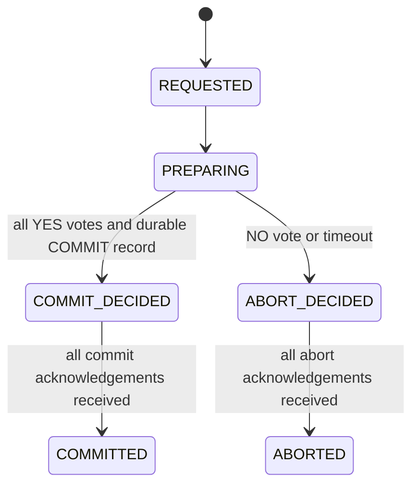
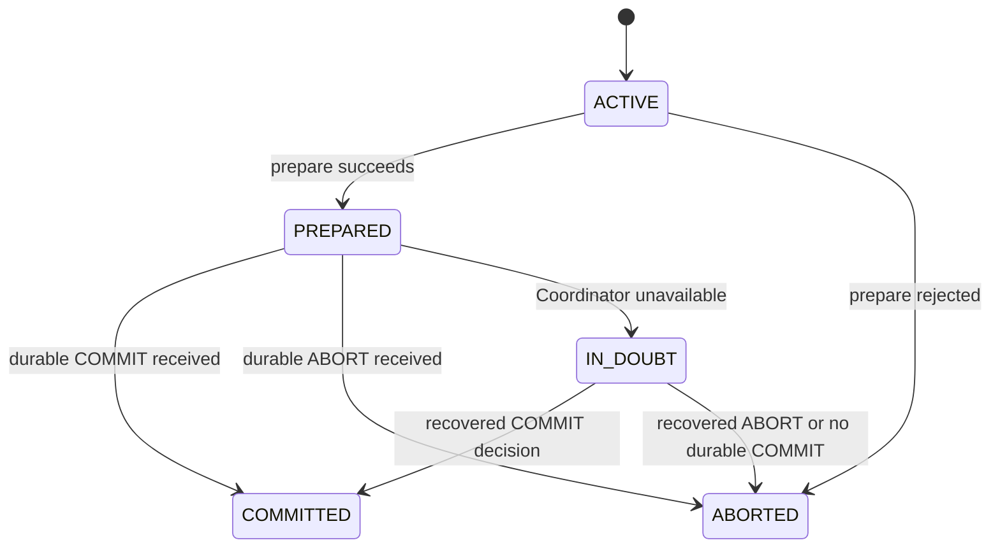
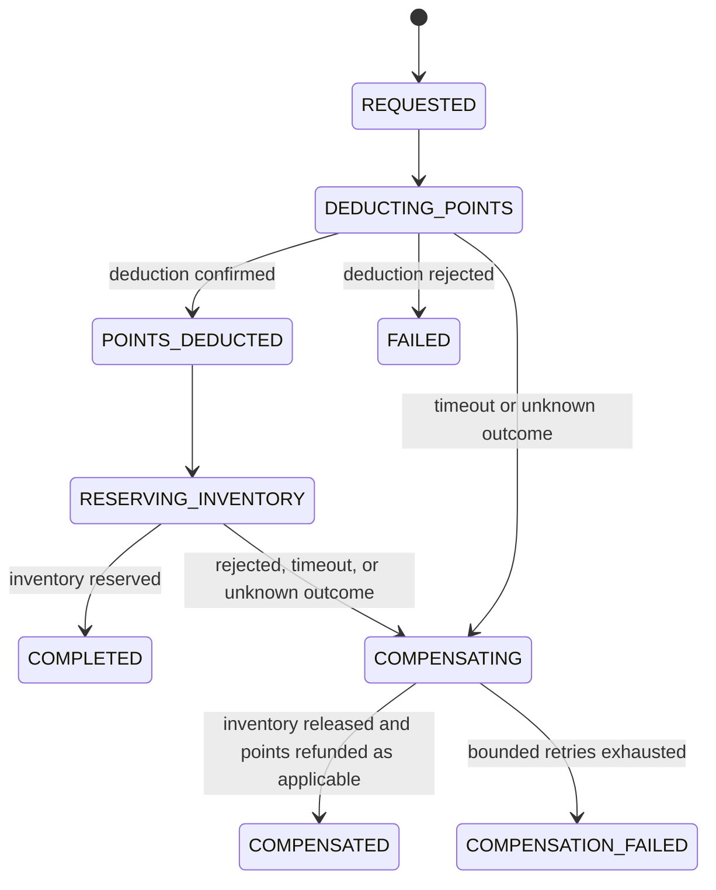

# ADR-001: LedgerMesh Architecture Decisions and Correctness Invariants

- **Status:** Proposed — requires approval from all four team members
- **Issue:** LM-001 / GitHub issue #3
- **Date:** 2026-11-02
- **Owners:** Entire LedgerMesh team

## 1. Context

LedgerMesh compares two approaches for coordinating a rewards redemption across independent services:

1. Two-Phase Commit (2PC), using synchronous prepare/commit/abort operations.
2. An orchestrated Saga, using asynchronous Kafka commands, result events, and compensating actions.

A redemption deducts points from a user's wallet and reserves one catalog reward. Partial failures, retries, duplicate messages, out-of-order delivery, concurrent requests, and coordinator crashes must not produce double spending, negative inventory, ghost reservations, or conflicting final outcomes.

This ADR fixes the vocabulary, service boundaries, allowed communication paths, workflow states, and correctness rules that later implementation issues must follow.

## 2. Service boundaries and data ownership

| Service | Owns | Must not do |
|---|---|---|
| Redemption Coordinator | Redemption request, selected mode, workflow state, durable decision, retry/compensation state | Directly update Wallet or Catalog tables |
| Wallet Service | User balance, balance version, point deduction/refund records, Wallet inbox/outbox | Read or update Catalog data |
| Rewards Catalog Service | Reward definitions, available inventory, inventory version, reservations, Catalog inbox/outbox | Read or update Wallet data |
| Audit Ledger Service | Append-only transaction events, decisions, failures, compensations, and recovery actions | Act as the source of truth for balances or inventory |
| Web Interface | User input and transaction-status display | Contain transaction coordination or business persistence logic |

Each service owns its database or isolated database schema. No service may directly query or mutate another service's tables. Cross-service work occurs through versioned APIs or Kafka messages.

## 3. Approved communication paths

### 3.1 Two-Phase Commit

- Client to Coordinator: synchronous REST.
- Coordinator to Wallet and Catalog: synchronous `prepare`, `commit`, `abort`, and `status` operations.
- Coordinator to Audit Ledger: publish outcome and recovery records asynchronously through a transactional outbox.
- The Coordinator must persist the final COMMIT or ABORT decision before sending it to participants.
- Participants must make prepare, commit, and abort operations idempotent.

### 3.2 Saga

- Client to Coordinator: synchronous REST to create a redemption and obtain a transaction ID.
- Coordinator to Wallet and Catalog: Kafka commands.
- Wallet and Catalog to Coordinator: Kafka result events.
- Every consumer uses a transactional inbox; every producer uses a transactional outbox.
- Kafka provides at-least-once delivery. LedgerMesh guarantees exactly-once **business effects** through idempotency, unique constraints, and conditional database updates—not by assuming exactly-once message delivery.

## 4. Shared terminology

| Term | Meaning |
|---|---|
| Transaction ID | Stable identifier for one redemption attempt |
| Idempotency key | Client-provided key preventing repeated API submissions from creating new transactions |
| Event ID | Globally unique identifier for one event instance |
| Correlation ID | Identifier used to reconstruct the complete redemption across services |
| Causation ID | ID of the command or event that directly caused this message |
| Aggregate ID | Business entity whose ordered state is changing, such as a user wallet or reward |
| Aggregate version | Monotonically increasing version assigned by the service that owns an aggregate and included on events describing that aggregate's state changes; it is not assigned by the Coordinator to commands |
| Workflow step | Expected position of an event in the redemption state machine |
| Compensation | A new business operation that semantically reverses an earlier completed Saga step |
| Fencing token | Monotonically increasing coordinator term used to reject commands from a stale leader |

## 5. Required event envelope

Every Kafka command and event must contain:

```json
{
  "schema_version": 1,
  "event_id": "uuid",
  "event_type": "wallet.points_deducted",
  "transaction_id": "uuid",
  "correlation_id": "uuid",
  "causation_id": "uuid",
  "aggregate_type": "wallet",
  "aggregate_id": "user-123",
  "aggregate_version": 4,
  "workflow_step": 2,
  "fencing_token": null,
  "occurred_at": "ISO-8601 UTC timestamp",
  "payload": {}
}
```

`fencing_token` is nullable in the baseline implementation and mandatory if the etcd leadership stretch goal is enabled.

For commands, `aggregate_version` is `null`. Commands identify the redemption with `transaction_id` and their expected position with `workflow_step`. The owning service assigns the next aggregate version to the event it emits after a successful state change. The Coordinator must not read another service's database or manufacture a version for a Wallet or Catalog aggregate.

## 6. Two-Phase Commit state models

Coordinator state model:



Participant state model:



Rules:

- `COMMIT_DECIDED` and `ABORT_DECIDED` are mutually exclusive and irreversible.
- `IN_DOUBT` is a participant condition, not a Coordinator state.
- A participant that has prepared must retain its prepared state until it learns the durable decision.
- The Coordinator must durably record `COMMIT_DECIDED` before sending COMMIT.
- A NO vote or timeout before a durable COMMIT decision leads to `ABORT_DECIDED`; a timeout must never replace a decision that is already durable.
- If the Coordinator crashes after receiving all YES votes but before durably recording COMMIT, recovery uses presumed abort: the recovered Coordinator records ABORT and tells prepared participants to roll back.
- If a durable COMMIT record exists, recovery continues sending COMMIT until every participant acknowledges it.
- Repeated final-decision messages return the already stored outcome.

## 7. Saga state model



Rules:

- A step advances only after the expected result for the current transaction and workflow step arrives.
- A timeout does not prove that an operation failed. The Wallet may deduct points, or the Catalog may reserve inventory, before its response is lost or delayed.
- A future event is deferred or retried until its causal predecessor arrives; after bounded retries it enters the dead-letter topic.
- When an outcome is unknown, the Coordinator enters compensation and requests inventory release and point refund as applicable.
- Compensation commands are idempotent. If the corresponding forward operation did not occur, the owning service records or returns a safe no-op result.
- `COMPLETED`, `FAILED`, and `COMPENSATED` are terminal outcomes. `COMPENSATION_FAILED` requires operator attention and is not reported as successful.

## 8. Ordering, idempotency, and concurrency decisions

1. Kafka messages are partitioned by the affected aggregate ID: Wallet commands by user ID and Catalog commands by reward ID.
2. Partition ordering is helpful but not sufficient. Command consumers validate `transaction_id`, `workflow_step`, and `causation_id` before applying a mutation. They do not reject commands using a Coordinator-supplied aggregate version.
3. Each inbox has a unique constraint on `event_id`. Concurrent attempts to process the same event allow only one accepted inbox record and one business mutation.
4. Wallet and Catalog mutations use database-level optimistic concurrency control:
   - Read the current version.
   - Apply an atomic conditional update using the expected version.
   - Increment the version on success.
   - Reload and re-evaluate on conflict instead of replaying blindly.
   - Assign the next aggregate version to the service-owned event after the state change succeeds.
5. Balance deduction and inventory reservation include atomic non-negative checks in the database transaction.
6. Redis Redlock is not required for the baseline. Database constraints and optimistic concurrency are the authoritative correctness mechanism.

Two redemptions for the same user or reward are independent transactions. Database-level optimistic concurrency control serializes conflicting business mutations inside the owning service without forcing the Coordinator to know or predict another service's current aggregate version.

## 9. Audit Ledger delivery and availability

An Audit Ledger outage must not block or reverse an otherwise valid redemption decision. The Coordinator durably records the transaction outcome and its audit event in the same local database transaction using a transactional outbox. Publication to the Audit Ledger occurs asynchronously and is retried until acknowledged.

The Audit Ledger consumes events idempotently using `event_id`. A temporary Ledger outage may delay audit visibility, but it cannot change a committed, completed, aborted, failed, or compensated business outcome. The synchronous 2PC decision path therefore does not depend on the Audit Ledger being available.

## 10. Correctness invariants

These invariants must hold after normal execution, retries, crashes, and recovery:

### INV-01: Non-negative wallet balance

For every wallet, `available_points >= 0`. Concurrent redemptions must never spend more points than are available.

### INV-02: Non-negative and bounded inventory

For every reward, `available_inventory >= 0`, and successful allocations cannot exceed the initial inventory plus legitimate restocks.

### INV-03: At most one business effect per operation

For a given transaction and operation type, a deduction, refund, reservation, or release changes business state at most once, regardless of API retry, duplicate delivery, or concurrent consumers.

### INV-04: One terminal outcome per redemption

A transaction can reach only one terminal outcome. It must never be both committed/completed and aborted/compensated.

### INV-05: Successful redemption is complete

A transaction reported as successful has exactly one committed point deduction and exactly one committed inventory allocation for the requested user and reward.

### INV-06: Unsuccessful redemption leaves no uncompensated effect

After recovery finishes, an aborted, failed, or compensated transaction cannot retain an unmatched point deduction or ghost inventory allocation.

### Terminal-state event rule

After a transaction reaches `COMMITTED`, `COMPLETED`, `ABORTED`, `FAILED`, or `COMPENSATED`, a late, reordered, or duplicate event cannot alter its terminal outcome. The consumer logs the ignored event with its `transaction_id` and `event_id`, increments an observability metric, and acknowledges or records it as ignored so that it is not processed repeatedly.

## 11. Planned invariant tests

| Invariant | Minimum automated tests |
|---|---|
| INV-01 | Concurrent redemptions against the same limited balance; duplicate deduction delivery |
| INV-02 | Concurrent requests for the final inventory unit; duplicate reservation delivery |
| INV-03 | Same event processed by multiple consumer threads; repeated API request using one idempotency key |
| INV-04 | Coordinator crash before and after decision; conflicting, duplicate, or late result event injection after every terminal state |
| INV-05 | 2PC and Saga happy paths followed by cross-service state verification |
| INV-06 | Catalog failure after deduction; compensation retry; participant and Coordinator restart |

The invariant checker will run after every integration test and controlled experiment. Any invariant violation fails the run, even if the API returned a nominally successful response.

## 12. etcd leadership stretch decision

If the stretch goal is implemented:

- A three-member etcd cluster provides quorum-backed coordinator leadership.
- Leadership acquisition and renewal use linearizable etcd operations and a lease.
- Only the valid lease holder accepts new redemptions.
- The Coordinator stops accepting work when it cannot renew its lease or verify quorum.
- Every leadership term produces a monotonically increasing fencing token.
- Wallet and Catalog persist the highest accepted token and reject commands with lower tokens.
- A network-isolated former leader cannot continue mutating business state even if it has not yet terminated.

## 13. Consequences and trade-offs

- Service-owned data prevents accidental shared-database coupling but requires explicit distributed coordination.
- 2PC provides atomic decisions but can block while a prepared participant cannot learn the decision.
- Saga improves independent recovery and availability but exposes intermediate states and requires correct compensations.
- Inbox/outbox, workflow-step validation, and optimistic concurrency add implementation complexity but are necessary under at-least-once delivery and races.
- Service-owned monotonic aggregate versions are chosen over full vector clocks because each aggregate has one owning service. Commands use transaction workflow metadata, while owner-emitted events carry aggregate versions.
- The etcd work remains isolated as a stretch goal so it cannot destabilize the required 2PC-versus-Saga experiment.

## 14. Team approval checklist

- [ ] Service ownership and allowed communication paths are approved.
- [ ] 2PC states and irreversible decision rules are approved.
- [ ] Saga states and compensating actions are approved.
- [ ] Event envelope and ordering strategy are approved.
- [ ] All six invariants have an assigned automated test.
- [ ] Terminology is used consistently in the README, APIs, events, schemas, and later issues.
- [ ] All four members approve this ADR in the pull request.

## 15. Definition of done for LM-001

LM-001 can be closed when this ADR is merged, all checklist items are approved, and any disputed decision is resolved in the pull-request discussion rather than left implicit.
